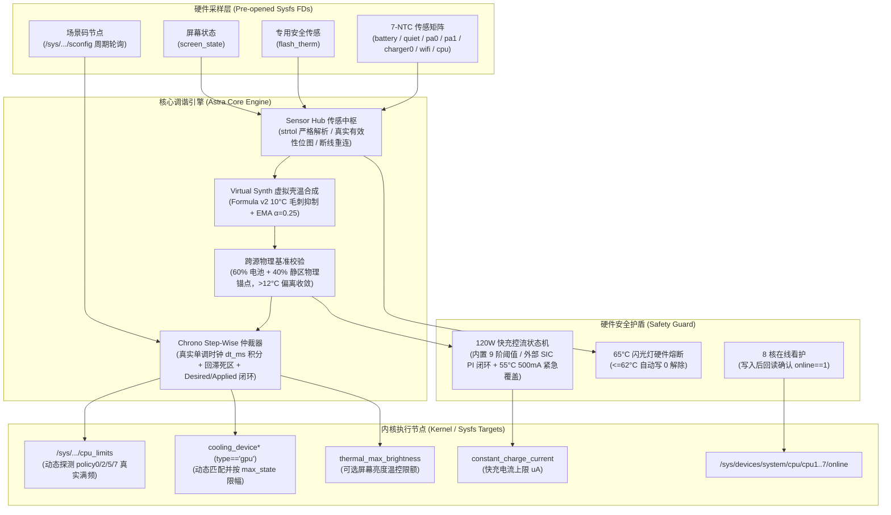

# AstraThermald

[](LICENSE)
[-green.svg>)]()
[]()
[]()
[]()

专为高通骁龙 8 Gen 3（SM8650，例如 Redmi K70 Pro / `manet` 等机型）编写的用户态独立温控守护进程。

做这个项目的初衷很简单：原厂 `mi_thermald` 在高负载下停核（`MONITOR-CCC`）和降频阶梯太激进，容易造成瞬时掉帧；而传统的“温控拜拜”直接删掉温控又会导致 120W 快充失去电流阶梯保护、手电筒高温无法自保。AstraThermald 选择在用户态接管 `mi_thermald`，锁死 8 核在线、平滑升降频阶梯，同时把快充降流与硬件过热底线完整保留下来。

---

## 架构与数据流 (Architecture & Data Flow)



---

## 功能实现状态与边界说明

为了便于开发者对照审查，下表列出了各子系统的真实代码实现范围：

| 模块 / 特性                            |    当前状态     | 实现说明                                                                                                                                                                                                                    |
| :------------------------------------- | :-------------: | :-------------------------------------------------------------------------------------------------------------------------------------------------------------------------------------------------------------------------- |
| **7-NTC 虚拟温度合成**                 | **Implemented** | 默认采用原厂 `[VIRTUAL-SENSOR0]` 权重 + Formula v2（$10.0^\circ\text{C}$ 单周期突变拦截，连续 3 帧放行）+ EMA（$\alpha=0.25$）；支持通过 `-c` 从外部配置动态注入自定义权重与补偿值。                                        |
| **跨源温度交叉校验**                   | **Implemented** | 已接入主循环。当电池与主板静区物理读数均真实有效时，对比合成温度与物理基准（`0.6 * batt + 0.4 * quiet`），温差 $>12.0^\circ\text{C}$ 时按比例融合收敛，避免使用自写自读的 `board_sensor_temp`。                             |
| **CPU 4 簇 Step-Wise 控频**            | **Implemented** | 启动时读取 `policy{0,2,5,7}/cpuinfo_max_freq` 真实上限，基于 `CLOCK_MONOTONIC` 真实毫秒差 `dt_ms` 执行升档/降档滞留积分，写入失败自动重开 FD 重试。                                                                         |
| **GPU `cooling_device` 控频**          | **Implemented** | 遍历 `cooling_device0..127` 严格校验 `type == "gpu"`（拒绝硬编码 cdev 编号），读取 `max_state` 限幅；启动首周期主动写 `0` 清除原厂遗留降频锁。                                                                              |
| **120W 快充 FCC 保护**                 | **Implemented** | 内置模式采用 9 档温度阶梯（$22\text{A} \to 500\text{mA}$）与极端过热（壳温 $\ge 55^\circ\text{C}$ 或电池 $\ge 48^\circ\text{C}$）$500\text{mA}$ 紧急覆盖统一仲裁；加载外部配置时支持 `[SIC-BAT]` 增量式 PI 控流。           |
| **闪光灯 $65^\circ\text{C}$ 防烧保护** | **Implemented** | 仅当 `flash_therm` 物理读数真实有效（非 fallback 值）且 $\ge 65^\circ\text{C}$ 时向 `temp_state` 写 `110100004`；回落至 $\le 62^\circ\text{C}$ 时显式写回 `0`/初始值解除锁定。                                              |
| **`sconfig` 动态场景感知**             | **Implemented** | 采用预开 FD 周期轮询 `/sys/class/thermal/thermal_message/sconfig`（非 `inotify`），识别游戏场景码（如 `6, 18, 19, 20, 25, 26, 76, 501, 700, 707`）自动切入 `ESPORTS` 档。                                                   |
| **`mi_thermald` 接管与恢复**           | **Implemented** | 记录接管前服务初始状态，通过 Android `init` 属性（`ctl.stop mi_thermald`）停止服务并轮询确认 `init.svc.mi_thermald == stopped`；**全程零 `/proc` 目录遍历**。                                                               |
| **外部 Supervisor 崩溃恢复**           | **Implemented** | 配套独立启动器 `astra_launcher` 在进程外监控 `astra_thermald`；若守护进程因 `SIGSEGV/SIGABRT/SIGKILL` 异常终止，由外部 Supervisor 恢复启动前硬件快照并拉起 `mi_thermald`。                                                  |
| **外部 `.conf` 配置规则支持**          |   **Partial**   | 完整解析并严格校验数组长度一致性。其中 `[ss]`（CPU 4 簇）、`[monitor]`（`gpu` 与 `thermal_max_brightness`）、`[sic]`（快充）和 `[virtual]` 已绑定执行器；其余外设规则（如 `modem`/`wifi`/`cdsp`）仅做语法校验，不干预硬件。 |

---

## 关于厂商配置解密与合规说明（Cleanroom 实现）

小米官方在 `/vendor/etc/thermal-map.conf` 及 `/odm/etc/thermal-*.conf` 中的策略配置采用了 AES-128-CBC 加密。

**本项目在源码和编译产物中均未硬编码任何厂商私有密钥或 IV。**

当用户通过 `-c` 指定加载加密的官方 `.conf` 文件时，AstraThermald 会在运行时以只读方式读取用户本机的 `/vendor/bin/mi_thermald` ELF64 二进制文件：

1. 优先解析 ELF64 `.rela.dyn` 重定位表中的相邻 `R_AARCH64_RELATIVE` GOT 指针项，定位数据段中的 16 字节 Key 与 IV 字符串（不要求 Key 与 IV 内容相同）；
2. 对提取出的候选 Key/IV 使用当前密文分组执行 PKCS#7 Padding 试解密闭环验证；
3. 提取与解密全程在用户手机本地内存中完成，数据不离机。

---

## 编译方法

编译需要 Android NDK（r26 / r27 及以上，目标 `aarch64-linux-android34`）。

### Windows 编译

直接运行目录下的 `build.bat`（脚本会自动按 `ANDROID_NDK_HOME`、`ANDROID_NDK_ROOT`、`NDK_DIR`、`%LOCALAPPDATA%\Android\Sdk\ndk` 顺序探测 NDK 工具链）：

```cmd
build.bat
```

编译完成后会在 `bin/` 目录下生成两个二进制文件：

- `bin/astra_thermald`：温控核心守护进程
- `bin/astra_launcher`：独立启动器与外部 Supervisor 崩溃看护进程

### Linux / macOS 编译

```bash
export ANDROID_NDK_HOME=/path/to/android-ndk
make
```

---

## 部署与使用说明

将编译好的二进制推送到手机 `/data/local/tmp/` 并赋予执行权限：

```bash
adb push bin/astra_thermald /data/local/tmp/astra_thermald
adb push bin/astra_launcher /data/local/tmp/astra_launcher
adb shell "su -c 'chmod 755 /data/local/tmp/astra_thermald /data/local/tmp/astra_launcher'"
```

### 方式一：通过独立启动器 `astra_launcher` 管理（推荐，带外部崩溃恢复保护）

```bash
# 启动并接管官方 mi_thermald（默认 auto 动态场景感知）
adb shell "su -c '/data/local/tmp/astra_launcher start auto'"

# 运行中无缝热切换档位（auto | balance | esports | beast | stock | /odm/etc/thermal-normal.conf）
adb shell "su -c '/data/local/tmp/astra_launcher profile esports'"

# 查看当前运行状态、mi_thermald 状态与 FCC 电流限额
adb shell "su -c '/data/local/tmp/astra_launcher status'"

# 优雅停止并恢复启动前硬件状态与官方 mi_thermald
adb shell "su -c '/data/local/tmp/astra_launcher stop'"
```

### 方式二：直接运行 `astra_thermald`

```text
用法: astra_thermald [选项]
选项:
  -p, --profile <name>   温控策略模式 (auto|beast|esports|balance|stock，默认: auto)
  -c, --config <file>    加载外部明文或加密的 .conf 策略配置文件
  -t, --takeover         停用官方 mi_thermald 并接管硬件温控节点
  -i, --interval <ms>    主循环采样周期 (100..10000 毫秒，默认: 1000)
  -l, --log <file>       指定日志输出文件路径 (超过 1MB 自动截断轮转)
  -d, --daemon           以 daemon 形式在后台运行
  -v, --version          查看版本信息
  -h, --help             显示帮助信息
```

---

## 作者与开源协议

- **作者**：Baizhi, Gemini
- **开源协议**：本项目采用 **GNU General Public License v3.0 (GPL-3.0)** 协议开源，详见 [LICENSE](LICENSE) 文件。
