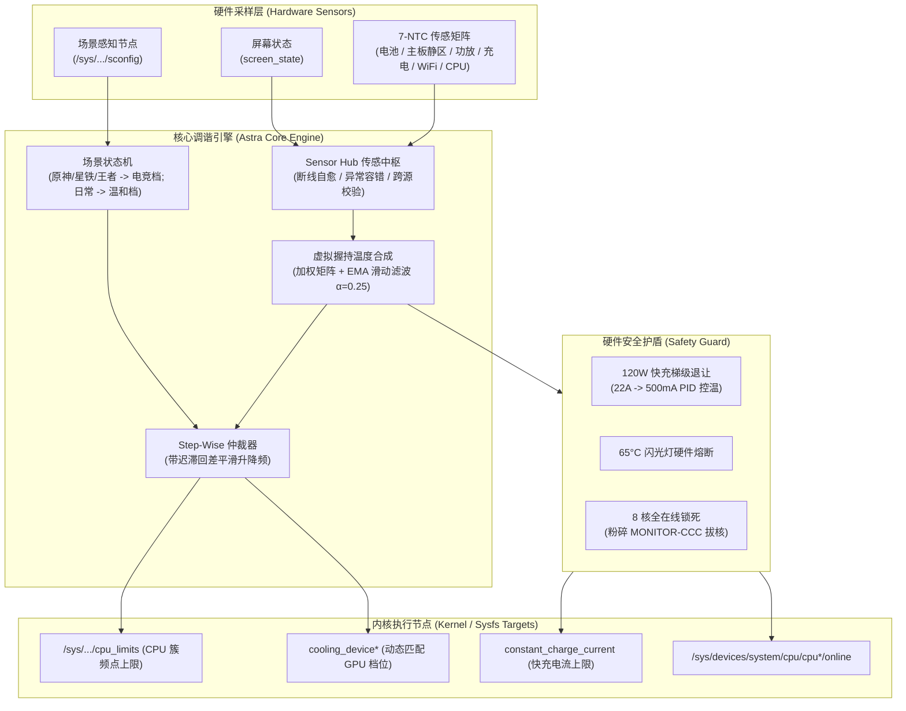

# AstraThermald

[](LICENSE)
[-green.svg)]()
[]()
[]()
[]()

专为高通骁龙 8 Gen 3（SM8650，例如 Redmi K70 Pro / Xiaomi 14 系列等）编写的用户态温控接管守护进程。

开发这个项目的初衷是为了彻底替代系统原厂的 `mi_thermald`，解决高负载场景下激进拔核、游戏掉帧卡顿的问题，同时避免像传统“温控拜拜”那样粗暴删除温控导致快充失效和机身过热无法自保。

---

## 架构与数据流 (Architecture & Data Flow)



---

## 为什么做这个项目？

目前小米 HyperOS / MIUI 官方的温控机制主要存在两个问题：
1. **激进拔核（MONITOR-CCC 机制）**：重载游戏（如原神、星铁）温度稍高时，系统会直接拔掉 Cortex-X4 超大核甚至大核，核心反复脱机/上线引发瞬时卡顿和掉帧。
2. **频点阶梯过于陡峭**：降频策略缺少回差阻尼，容易在临界温度附近高频跳档（温控打架）。

很多玩家会选择用 Magisk/KernelSU 模块直接干掉温控（俗称“温控拜拜”），但这样做的副作用同样明显：
- **失去快充电流保护**：120W / 90W 澎湃秒充失去温控调节，发热时无法阶梯降流，存在电池鼓包与热失控隐患。
- **失去极端保护**：闪光灯没有高温熔断自保，强行常亮可能烧坏灯珠。

**AstraThermald** 的思路不是“粗暴干掉温控”，而是**重新实现一套更合理、更平滑的温控守护**：
- **锁死 8 核全在线**：彻底封印拔核逻辑，确保高负载场景下全核心稳定调度。
- **7-NTC 热敏电阻加权合成**：复刻原厂握持温度加权算法，并加入 EMA 指数平滑滤波，消除温阶抖动。
- **保留物理安全底线**：完整保留 120W 快充阶梯降流（22A ~ 500mA）和 65°C 闪光灯硬件熔断保护。
- **自动场景感知**：监听系统的 `sconfig` 状态，打游戏自动切激进电竞策略，日常使用切温和省电策略。

---

## 关于专有密钥与合规说明（Cleanroom 实现）

小米官方的部分温控策略配置文件（如 `/vendor/etc/thermal-map.conf`）使用了 AES-128-CBC 加密。

**为了保障合规，本项目在源码和发布二进制中未硬编码任何厂商的私有密钥与 IV。**

如果用户选择加载并解密官方的 `.conf` 配置文件，AstraThermald 会在运行时以只读方式打开用户自己手机上的 `/vendor/bin/mi_thermald`，通过内存模式扫描就地读取该设备所用的密钥进行解密。提取与解密全部在用户本地手机内存中完成，数据不离机，不存在侵权或泄露厂商机密的法律风险。

---

## 核心特性

- **永不拔核**：启动后严密防守 CPU 核心在线状态，且避免高频重复写 `online` 节点引发的内核锁争夺。
- **平滑温控**：机身握持温度采用 7 路物理 NTC（电池、主板静区、功放、充电芯片、WiFi、CPU 等）加权合成，配合迟滞回差（Hysteresis Deadband）消除顿挫。
- **动态接管 mi_thermald**：自动停止官方温控服务，并在后台巡检防范系统服务（如 Joyose / powerkeeper）将其后台复活。
- **息屏低功耗**：识别屏幕亮灭状态，息屏时自动将轮询放宽至 3000ms 并暂停频繁操作，允许 CPU 进入深休眠（C-State）。
- **自带日志轮转**：守护进程内置大小监控，日志超过 1MB 自动重置，避免长时间运行把 `/data` 空间塞满或引起 I/O 延迟。

---

## 编译方法

编译需要 Android NDK（建议 r25 及以上版本，支持 API 34）。

### Windows 编译
直接双击运行或在终端执行目录下的 `build.bat`：
```cmd
build.bat
```
脚本会自动探测系统的 NDK 路径并生成 `bin/astra_thermald`。

### Linux / macOS 编译
指定 NDK 编译器路径后直接执行 make：
```bash
export CC=$NDK_DIR/toolchains/llvm/prebuilt/linux-x86_64/bin/aarch64-linux-android34-clang
make
```

---

## 使用说明

编译完成后，通过 ADB 将二进制推送到手机：

```bash
adb push bin/astra_thermald /data/local/tmp/astra_thermald
adb shell "su -c 'chmod 755 /data/local/tmp/astra_thermald'"
```

### 推荐启动命令（自动接管 + 场景感知）
```bash
# 前台调试运行
su -c '/data/local/tmp/astra_thermald -p auto -t'

# 后台静默守护运行
su -c 'nohup /data/local/tmp/astra_thermald -p auto -t > /data/local/tmp/astra_thermald.log 2>&1 & echo $! > /data/local/tmp/astra_thermald.pid'
```

### 命令行参数
```text
选项:
  -p, --profile <name>   温控策略模式 (auto|beast|esports|balance|stock，默认: auto)
  -c, --config <file>    加载外部明文或加密的 .conf 策略配置文件
  -t, --takeover         停用官方 mi_thermald 并全面接管硬件节点
  -i, --interval <ms>    主循环采样周期 (毫秒，默认: 1000)
  -d, --daemon           以 daemon 形式在后台运行
  -v, --version          查看版本信息
  -h, --help             显示帮助信息
```

---

## 作者与鸣谢

- **作者**：Baizhi, Gemini
- **特别感谢**：开源社区中所有致力于高通平台性能调优与 Linux 内核热工架构研究的开发者。

---

## 开源协议

本项目采用 **GNU General Public License v3.0 (GPL-3.0)** 协议开源，详情见 [LICENSE](LICENSE) 文件。
